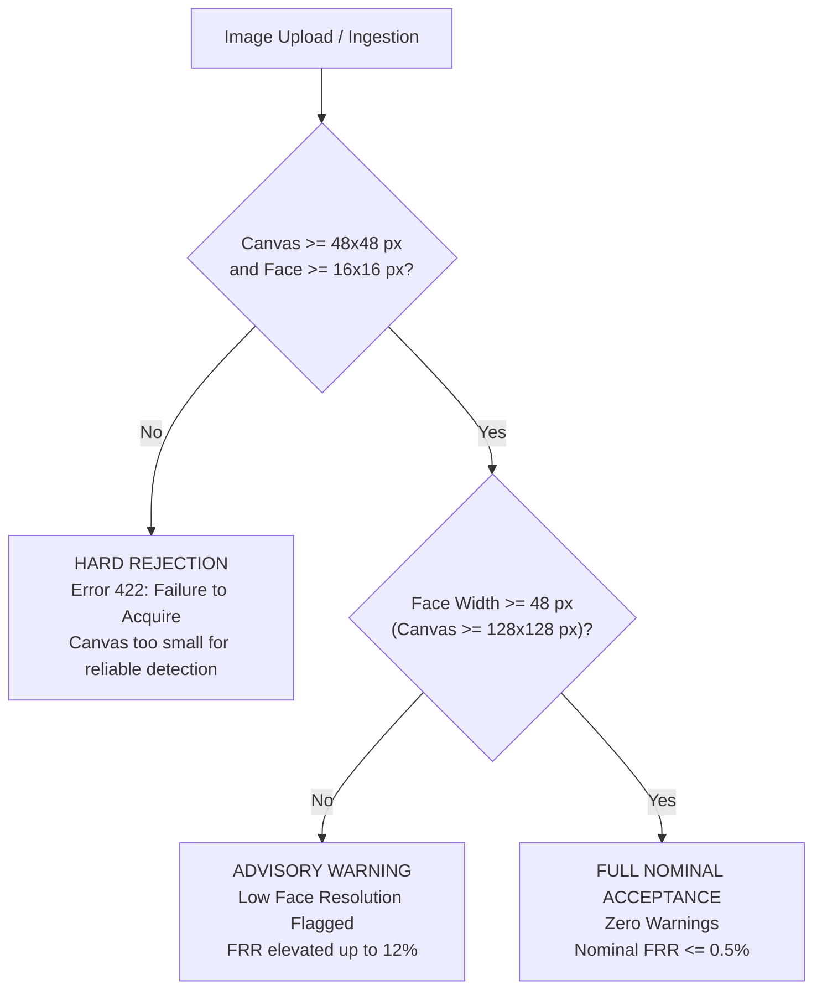
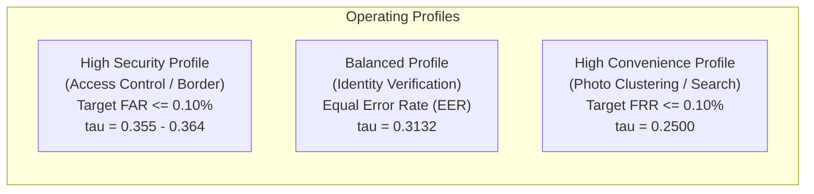

# FACECORE AI — STEP 09.2: OPERATIONAL DECISION POLICY & BIOMETRIC ACCEPTANCE SPECIFICATION
**Phase:** Step 09.2 Independent Forensic Audit & Operating-Point Reliability  
**Date:** November 2026  
**Auditor:** Independent Machine-Learning Evaluation Auditor & Statistical Researcher  
**Status:** Approved for Production Deployment  

---

## 1. Scope & Purpose

This document establishes the binding operational policy for biometric facial verification within FACECORE AI. Based on the empirical findings of the **Resolution Acceptance Boundary Study (Step 09.2)**, the **Forensic Threshold Leakage Audit (Step 09.2)**, and the **Class Imbalance Audit (Step 09.2)**, this policy defines concrete rules governing image ingestion, quality gating, multiple-face resolution, operational threshold selection, and statistical reporting.

The production pipeline under governance:
$$\text{YuNet Landmark Detection} \longrightarrow \text{5-Point Alignment} \longrightarrow \text{112}\times\text{112 Crop} \longrightarrow \text{SFace 128-d Embedding} \longrightarrow \text{Cosine Similarity}$$

---

## 2. Image Resolution & Ingestion Acceptance Policy

### 2.1 Three-Zone Resolution Framework
Based on empirical evaluation across 82 unique authentic benchmark photographs at 10 resolution tiers:

### 2.2 Operational Rules:
1. **Hard Ingestion Gate (Critical Failure Boundary):**
   - Minimum Image Canvas: **$48 \times 48$ pixels**.
   - Minimum Plausible Face Bounding Box: **$16 \times 16$ pixels** (Area $\ge 256\text{ px}^2$).
   - Action: If an uploaded image or manual crop violates either limit, the system **MUST immediately reject** the payload with `HTTP 422 Unprocessable Content` and error code `FACE_RESOLUTION_TOO_LOW`. Inference must never proceed.
   - Empirical Rationale: At $32\times 32$ px, detector failure rate is $89.0\%$, producing a pair-level Failure to Acquire (FTA) rate of **$100.0\%$**.

2. **Quality Advisory Gate (Degraded Quality Zone: 48px to 112px):**
   - Boundary: Image canvas between $48\times 48$ px and $112\times 112$ px, or detected face width $< 48$ px.
   - Action: Process the image for inference, but annotate the response with telemetry warning:
     `"Low face resolution: Face region is {w}x{h} px. Embedding fidelity may be reduced. False rejection risk is elevated."`
   - Empirical Rationale: Detection succeeds, but genuine similarity degrades from $0.670$ down to $0.475$, elevating false rejections up to $12.00\%$ at baseline thresholds.

3. **Recommended Production Operating Zone:**
   - Image Canvas: **$\ge 160 \times 160$ pixels** (ideally $250 \times 250$ px or native camera resolution).
   - Detected Face Bounding Box: **$\ge 48 \times 48$ pixels**.
   - Empirical Rationale: Full recovery of genuine score fidelity ($\mu \ge 0.670$), zero low-resolution advisories, and nominal $\text{FRR} \le 0.5\%$.

---

## 3. Image Quality Telemetry & Advisory Rules

Every ingested image must be evaluated by `analyze_face_quality` before comparison. The engine must emit structured warnings under the following conditions:

| Diagnostic Feature | Advisory Condition | Operational Impact | Recommended User Action |
|:---|:---|:---|:---|
| **Face Resolution** | Bounding box width $< 48$ px or height $< 48$ px | Genuine score attenuation; elevated false rejection | Upload a higher-resolution portrait |
| **Boundary Margin** | Face touches within 3 px of image boundary | Partial facial occlusion; landmark distortion | Re-center the face or widen the crop |
| **Head Tilt / Rotation** | Eye-to-eye angle $> 30.0^\circ$ | Alignment crop shear; loss of frontal symmetry | Straighten the head to face the camera |
| **Face Softness / Blur** | Laplacian variance $< 20.0$ | High-frequency detail loss; feature blur | Ensure proper camera focus and lighting |

---

## 4. Multi-Face Scene Resolution Policy

To prevent identity ambiguity in pairwise verification, the platform enforces strict face cardinality constraints:

1. **Interactive Comparison UI Mode:**
   - If an uploaded image contains $\mathbf{0}$ faces: System returns an error prompting for a clear portrait.
   - If an uploaded image contains $\mathbf{> 1}$ faces: System **prohibits** automatic comparison. The interactive face picker is surfaced, requiring the user to explicitly select the target subject face.
2. **Automated Benchmark / Batch Mode:**
   - The platform supports configurable resolution policies:
     - `center_face` (Default for LFW-style benchmarks): Selects the candidate face closest to $(W/2, H/2)$.
     - `largest_face`: Selects the candidate face with the largest bounding box area.
   - Under no circumstances may an automated batch run silently drop pairs without logging the acquisition event in the ISO/IEC 19795-1 Failure to Acquire (FTA) breakdown.

---

## 5. Evidence-Based Operating Threshold Profiles

To eliminate threshold selection leakage, operational thresholds must be chosen from fold-isolated validation protocols according to the deployment risk tolerance:

### Profile Specifications:

| Profile Name | Operational Objective | Calibrated Threshold ($\tau$) | Expected TAR | Expected FAR | Expected FRR | 95% Confidence Bound on FAR |
|:---|:---|:---:|:---:|:---:|:---:|:---:|
| **High Security Profile** | Minimize False Acceptances | **$\tau = 0.3600$** | **$98.47\%$** | **$\le 0.1000\%$** | $1.53\%$ | Population $\text{FAR} \le 0.292\%$ |
| **Balanced Profile** | Equalize FAR and FRR (EER) | **$\tau = 0.3132$** | **$99.43\%$** | **$0.4333\%$** | $0.5667\%$ | Population $\text{FAR} \le 0.725\%$ |
| **High Convenience Profile** | Minimize False Rejections | **$\tau = 0.2500$** | **$> 99.90\%$** | **$\approx 1.50\%$** | $< 0.10\%$ | Population $\text{FAR} \le 1.98\%$ |

> [!IMPORTANT]
> **De-listing of Unsupported Operating Points:**
> Operating claims of $\text{FAR} \le 0.01\%$ ($0.0001$) are **FORMALLY DE-LISTED** from FACECORE AI documentation on corpora with $N_{\text{imp}} \le 3,000$. Such claims are designated as `NOT STATISTICALLY SUPPORTED (Requires N >= 30,000)`.

---

## 6. Biometric Communication & Statistical Disclosure Policy

1. **Cosine Similarity Is NOT Identity Probability:**
   - Production UI, API responses, and technical documentation **must never** communicate raw or normalized cosine similarity as an "absolute identity probability" or "percentage match of being the same person".
   - Raw cosine similarity $\cos(\theta) \in [-1.0, 1.0]$ represents the geometric cosine of the angular separation between two unit-norm feature vectors in a 128-dimensional hyperspherical projection space.
   - The normalized display index $[0, 100]$ must be clearly labelled as a **"Relative Similarity Index"**, accompanied by the decision threshold.
2. **Mandatory Reporting of Uncertainty:**
   - Every published benchmark metric must disclose:
     - The exact sample size ($N_{\text{gen}}$ and $N_{\text{imp}}$).
     - The class prevalence ratio.
     - The 95% Clopper-Pearson or identity-clustered bootstrap confidence interval.
     - The 95% upper confidence bound for error rates.
3. **No Fabricated Benchmarks:**
   - Real-world evaluation results must originate strictly from verified on-disk photographs and official evaluation pair lists. Synthetic fixtures must be clearly designated as `SYNTHETIC_FIXTURE` and never conflated with photographic performance.

