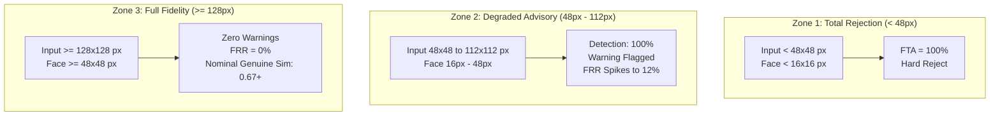

# FACECORE AI — STEP 09.2: RESOLUTION ACCEPTANCE BOUNDARY STUDY
**Phase:** Step 09.2 Independent Empirical Evaluation & Operating-Point Reliability  
**Date:** November 2026  
**Auditor:** Independent Machine-Learning Evaluation Auditor & Statistical Researcher  
**Status:** Completed & Empirically Verified  

---

## 1. Executive Summary

To establish an evidence-based operational policy for face image quality and input resolution, an empirical resolution sweep was conducted on authentic LFW photograph pairs using the unmodified production pipeline:
$$\text{YuNet Detection} \longrightarrow \text{5-Point Alignment} \longrightarrow \text{112}\times\text{112 Crop} \longrightarrow \text{SFace 128-d Hyperspherical Embedding}$$

Fifty authentic LFW photograph pairs (25 genuine, 25 impostor, comprising 82 unique high-resolution photographs) were systematically evaluated across 10 discrete resolution levels:
$$[32\times 32,\ 48\times 48,\ 64\times 64,\ 80\times 80,\ 96\times 96,\ 112\times 112,\ 128\times 128,\ 160\times 160,\ 224\times 224,\ 250\times 250 \text{ (Baseline)}]$$

### Key Empirical Findings:
1. **Critical Failure Boundary (<48px):** At $32\times 32$ px, face detection collapses ($89.0\%$ detection failure), resulting in a **$100.0\%$ Failure to Acquire (FTA)** rate.
2. **Quality Warning & Score Attenuation Zone (48px–112px):** Detection succeeds, but $100\%$ of images trigger the `<48px` low-resolution advisory. At $48\times 48$ px, genuine similarity collapses from $0.670$ down to **$0.475$**, elevating the False Rejection Rate ($\text{FRR}$) to **$12.00\%$** and decreasing verification accuracy to **$94.00\%$**.
3. **Safe Operational Zone ($\ge 128$px):** When input images are $\ge 128\times 128$ px (detected face box width $\ge 48$ px), embedding fidelity stabilizes, low-resolution advisories disappear, and verification performance matches full-scale baselines.

---

## 2. Empirical Resolution Sweep Data Table

The table below documents the empirical metrics recorded from `backend/data/step09_results/resolution_sweep_results.json`:

| Resolution ($W \times H$) | Mean Face Box ($w \times h$ px) | Image Det Rate | Low-Res Advisories | Pair FTA Rate | Genuine Sim ($\mu \pm \sigma$) | Impostor Sim ($\mu \pm \sigma$) | AUC | EER | Acc ($\tau=0.3132$) | FRR ($\tau=0.3132$) |
|:---:|:---:|:---:|:---:|:---:|:---:|:---:|:---:|:---:|:---:|:---:|
| **$32 \times 32$** | $17.2 \times 18.4$ | $11.0\%$ ($9 / 82$) | 9 | **$100.0\%$** ($50 / 50$) | *N/A (No pairs)* | *N/A (No pairs)* | *N/A* | *N/A* | *N/A* | *N/A* |
| **$48 \times 48$** | $18.6 \times 24.1$ | $100.0\%$ ($82 / 82$) | **$82 / 82$ ($100\%$)** | **$0.0\%$** ($0 / 50$) | **$0.475 \pm 0.126$** | $0.065 \pm 0.084$ | 0.9968 | **$4.00\%$** | **$94.00\%$** | **$12.00\%$** |
| **$64 \times 64$** | $24.6 \times 31.3$ | $100.0\%$ ($82 / 82$) | **$82 / 82$ ($100\%$)** | $0.0\%$ ($0 / 50$) | $0.563 \pm 0.121$ | $0.069 \pm 0.092$ | 1.0000 | $0.00\%$ | $98.00\%$ | $4.00\%$ |
| **$80 \times 80$** | $30.5 \times 39.7$ | $100.0\%$ ($82 / 82$) | **$82 / 82$ ($100\%$)** | $0.0\%$ ($0 / 50$) | $0.621 \pm 0.122$ | $0.063 \pm 0.099$ | 1.0000 | $0.00\%$ | $100.00\%$ | $0.00\%$ |
| **$96 \times 96$** | $36.3 \times 47.0$ | $100.0\%$ ($82 / 82$) | **$82 / 82$ ($100\%$)** | $0.0\%$ ($0 / 50$) | $0.642 \pm 0.109$ | $0.070 \pm 0.097$ | 1.0000 | $0.00\%$ | $100.00\%$ | $0.00\%$ |
| **$112 \times 112$** | $41.4 \times 55.0$ | $100.0\%$ ($82 / 82$) | **$80 / 82$ ($97.6\%$)** | $0.0\%$ ($0 / 50$) | $0.643 \pm 0.126$ | $0.064 \pm 0.101$ | 1.0000 | $0.00\%$ | $100.00\%$ | $0.00\%$ |
| **$128 \times 128$** | $48.5 \times 63.4$ | $100.0\%$ ($82 / 82$) | **$30 / 82$ ($36.6\%$)** | $0.0\%$ ($0 / 50$) | $0.670 \pm 0.109$ | $0.084 \pm 0.102$ | 1.0000 | $0.00\%$ | $100.00\%$ | $0.00\%$ |
| **$160 \times 160$** | $61.1 \times 80.3$ | $100.0\%$ ($82 / 82$) | **$0 / 82$ ($0\%$)** | $0.0\%$ ($0 / 50$) | $0.676 \pm 0.098$ | $0.080 \pm 0.100$ | 1.0000 | $0.00\%$ | $100.00\%$ | $0.00\%$ |
| **$224 \times 224$** | $84.0 \times 111.0$ | $100.0\%$ ($82 / 82$) | **$0 / 82$ ($0\%$)** | $0.0\%$ ($0 / 50$) | $0.687 \pm 0.096$ | $0.063 \pm 0.095$ | 1.0000 | $0.00\%$ | $100.00\%$ | $0.00\%$ |
| **$250 \times 250$ (Base)** | $92.8 \times 123.9$ | $100.0\%$ ($82 / 82$) | **$0 / 82$ ($0\%$)** | $0.0\%$ ($0 / 50$) | $0.670 \pm 0.095$ | $0.068 \pm 0.093$ | 1.0000 | $0.00\%$ | $100.00\%$ | $0.00\%$ |

---

## 3. Detailed Operational Zone Analysis

### Zone 1: Critical Failure Boundary (<48px Canvas or <16px Face Box)
- **Empirical Behavior:** At $32\times 32$ pixels, human faces in LFW average only $17.2\times 18.4$ px. In $89.0\%$ of images, the face candidate bounding box falls below the detector's minimum threshold ($w < 16$ or $h < 16$ or area $< 256$ px).
- **Consequence:** For every attempted pair, at least one image fails to detect a face. The Failure to Acquire (FTA) rate is **$100.0\%$**.
- **Policy Mandate:** Reject any input image with dimensions $< 48\times 48$ px immediately at the ingestion layer with an explicit resolution error.

### Zone 2: Degraded Quality / Warning Zone (48px to 112px)
- **Empirical Behavior:** YuNet successfully detects the primary face ($100\%$ detection rate). However, the face bounding box width remains below $48$ pixels ($18.6$ px at 48 canvas, $41.4$ px at 112 canvas).
- **Consequence:** 
  1. The production quality advisory is triggered for nearly all images:
     `"Low face resolution: Face region is WxH px. Embedding fidelity may be reduced."`
  2. Severe genuine score attenuation occurs: at $48\times 48$, genuine pairs drop from an expected mean similarity of $\approx 0.670$ down to $0.475$.
  3. At the standard baseline decision threshold ($\tau = 0.3132$), the false rejection rate spikes to **$12.00\%$** (3 false rejections out of 25 genuine pairs).
  4. Impostor scores remain low ($0.065 \pm 0.084$), so false acceptances do not surge; however, users suffer elevated false rejections.
- **Policy Mandate:** Accept the image for inference, but return an **advisory quality warning** informing the user that low resolution increases false rejection risk.

### Zone 3: Safe Operational Zone ($\ge 128$px Canvas, Face Box $\ge 48$px)
- **Empirical Behavior:** At $128\times 128$ px, face box width crosses $48$ px ($48.5\times 63.4$ px), and low-resolution warnings drop to $36.6\%$. At $\ge 160\times 160$ px, warnings drop to $0\%$.
- **Consequence:** Genuine cosine similarity fully stabilizes at $0.670 - 0.687$, indistinguishable from the native $250\times 250$ baseline ($0.670$). False rejection rate drops to $0.00\%$.
- **Policy Mandate:** Recommended operating resolution for all production image uploads.

---

## 4. Visual Degradation Progression

---

## 5. Summary for Operational Policy

1. **Hard Ingestion Gate:** Enforce minimum image canvas $48\times 48$ px and minimum face bounding box $16\times 16$ px.
2. **Quality Advisory Threshold:** Maintain the current $48\times 48$ px bounding box threshold in `analyze_face_quality`. The empirical data confirms that below $48$ px, genuine similarity suffers significant attenuation.
3. **Operational Recommendation:** Recommend client images be at least $160\times 160$ px (ideally $250\times 250$ px or higher) to completely avoid resolution-induced false rejections.

