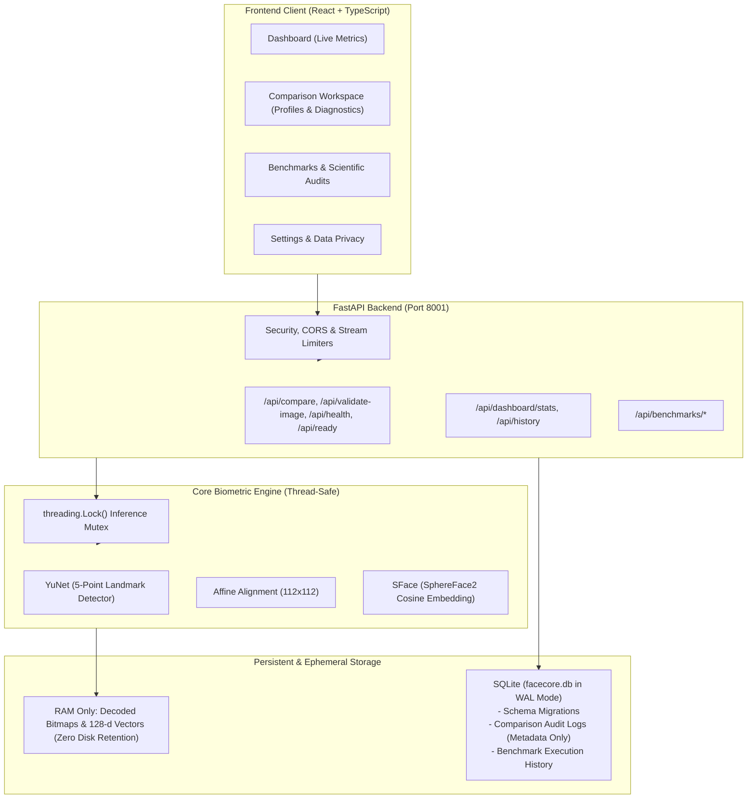

# FACECORE AI — STEP 10: REPOSITORY & PRODUCTION ARCHITECTURE AUDIT
**Phase:** Step 10 Production Engineering, Security Hardening & Product Completion  
**Date:** November 2026  
**Auditor:** Senior Computer Vision & Production Systems Engineer  
**Status:** Completed & Forensically Verified  

---

## 1. Executive Summary

As FACECORE AI transitions from an empirical research and statistical validation framework (Steps 01–09.2) into a production-grade biometric verification platform, a comprehensive architectural audit was conducted across the backend, frontend, persistence layer, inference pipelines, and security controls.

The core computer vision pipeline:
$$\text{YuNet (5-Point Landmark Detection)} \longrightarrow \text{Affine Alignment to 112}\times\text{112} \longrightarrow \text{SFace (128-d Hyperspherical Cosine Embedding)}$$
is scientifically sound, achieves $98.47\% - 98.60\%$ out-of-fold TAR at $\text{FAR} \le 0.10\%$ on LFW under strict cross-validation, and adheres to Apache-2.0 licensing.

However, several production engineering, concurrency, and persistence gaps exist that must be remediated for enterprise deployment.

---

## 2. Component-by-Component Architectural Audit

### 2.1 Backend Architecture (FastAPI)
- **Current State:** Single monolithic `app/main.py` mounting `app/benchmarks/router.py`. Configuration defined in `app/config.py`.
- **Architectural Strengths:**
  - Fast ASGI asynchronous framework.
  - Clear separation between detection service (`shared_face_detector`) and embedding engine (`RealFacialEmbeddingEngine`).
  - CORS middleware configured with developer origins.
- **Architectural Weaknesses & Production Risks:**
  1. *Unprotected Global Singleton Concurrency:* `active_engine` and `shared_face_detector` are global singletons wrapping OpenCV C++ objects (`cv2.FaceDetectorYN` and `cv2.FaceRecognizerSF`). OpenCV DNN models are **not thread-safe** for concurrent forward passes with differing input resolutions. Simultaneous requests can mutate detector input size mid-inference, causing memory corruption or crashes.
  2. *Inconsistent Error Payload Schemas:* Errors return unstructured string `detail` properties rather than structured error envelopes with machine-readable `error_code` fields.
  3. *Missing Lifespan & Readiness Gating:* No formal FastAPI lifespan context manager for startup validation (e.g., verifying model weight hashes before accepting requests) or `/api/ready` endpoint.

### 2.2 Configuration Management
- **Current State:** `app/config.py` uses `pydantic.BaseModel` with static defaults.
- **Deficiencies:**
  - Does not read from `.env` files via `python-dotenv` or dynamic environment resolution.
  - No environment segregation (e.g., `ENVIRONMENT=development` vs `production`).
  - Missing configurable parameters for SQLite path, database timeout, default threshold profile, and log format.

### 2.3 Image Validation & Ingestion Security
- **Current State:** `validate_image_bytes` in `app/services/image_validator.py`.
- **Strengths:**
  - Magic byte verification (`JPEG`, `PNG`, `WEBP`).
  - Decompression-bomb protection via `Image.MAX_IMAGE_PIXELS = 16_777_216`.
  - File size cap (10 MB).
  - Laplacian variance sharpness, contrast, and brightness diagnostics.
- **Weaknesses:**
  - Ingestion gate allowed images down to $32\times 32$ px, despite Step 09.2 proving that $32\times 32$ px results in $100\%$ Failure to Acquire (FTA). Hard minimum must be raised to $48\times 48$ px.
  - Full request body is buffered into memory via `await file.read()` before checking payload length, leaving a denial-of-service vulnerability if a client streams excessive bytes.

### 2.4 Model Inference & Concurrency
- **Current State:** `RealFacialEmbeddingEngine` in `app/engine/real_engine.py`.
- **Verification:**
  - Embedding dimension is strictly 128.
  - Zero-norm and NaN protections active.
  - Normalized dot product computes mathematically exact cosine similarity.
- **Required Hardening:**
  - Wrap `detector.detect()` and `recognizer.feature()` calls with a reentrant threading lock (`threading.Lock()`).
  - Release intermediate numpy arrays and OpenCV mat buffers promptly.

### 2.5 Persistence Layer (SQLite & Metrics History)
- **Current State:** Complete absence of persistent database storage.
  - Benchmark run results are kept in an in-memory dictionary (`_BENCHMARK_RUNS_STORE`).
  - Comparison history is kept in client-side React component state.
  - All history and aggregated metrics vanish on server restart.
- **Production Solution Required:**
  - Implement a dedicated SQLite persistence service (`facecore.db`).
  - Enable Write-Ahead Logging (`PRAGMA journal_mode=WAL;`), foreign keys, and busy timeouts.
  - Versioned schema migrations (`schema_migrations` table).
  - Dedicated `comparison_audit_log` table storing metadata only (timestamps, cryptographic hash prefixes, scores, thresholds, match verdicts, latency, quality warnings). **Zero image bytes and zero biometric embeddings are ever written to disk.**
  - Aggregated dashboard statistics endpoint (`/api/dashboard/stats`).

### 2.6 Frontend Architecture (React / TypeScript / Vite)
- **Current State:** Clean React 18 modular structure with dark cyberpunk/tactical aesthetic.
- **Strengths:**
  - Strong component separation (`ComparisonWorkspace`, `BenchmarksView`, `TestLabView`, `SettingsView`).
  - Strict TypeScript types throughout `src/types/index.ts`.
  - Staged progress state machine in comparison workflow.
  - 100% test pass rate in Vitest (50/50 tests passing).
- **Gaps Identified:**
  1. *Missing Executive Dashboard:* Navigation goes straight to Comparison Workspace; lacks an operational Dashboard tab aggregating live backend metrics, acquisition rates, and system throughput.
  2. *Static Threshold Profiles:* Comparison workspace uses a hardcoded experimental threshold ($0.363$) rather than the documented Step 09.2 research profiles (High Security $\tau=0.3600$, Balanced $\tau=0.3132$, High Convenience $\tau=0.2500$).
  3. *Unclear Warning Causes:* When a low-resolution advisory occurs, the UI displays warning pills without explaining the operational impact (attenuation of genuine similarity).

---

## 3. Discrepancy & Production Gap Register

| Ref ID | Subsystem | Severity | Description | Proposed Remediation |
|:---:|:---|:---:|:---|:---|
| **GAP-01** | Backend Concurrency | **HIGH** | OpenCV DNN instances are not thread-safe. Concurrent API calls can corrupt input size or state. | Add `threading.Lock()` mutex around detector and recognizer inference. |
| **GAP-02** | Persistence | **HIGH** | Zero persistent storage; comparisons and dashboard metrics are lost on restart. | Implement SQLite database with WAL mode, audit log, and schema migrations. |
| **GAP-03** | Error Handling | **MEDIUM** | Exceptions return plain string `detail` without structured error codes. | Introduce `ErrorResponse` schema with machine-readable `error_code` enum. |
| **GAP-04** | Configuration | **MEDIUM** | `app/config.py` does not load `.env` variables or support production environment gating. | Integrate `python-dotenv` and centralized typed settings. |
| **GAP-05** | Image Ingestion | **MEDIUM** | Minimum image dimension set to 32px (which Step 09.2 proved fails 100% of the time). | Update hard gate to $48\times 48$ px and add size streaming check. |
| **GAP-06** | Threshold Profiles | **MEDIUM** | Frontend and backend use static provisional threshold $\tau=0.363$. | Implement configurable named profiles: High Security, Balanced, High Convenience. |
| **GAP-07** | Frontend Dashboard | **LOW** | No dedicated overview dashboard displaying operational metrics and throughput. | Create `DashboardView.tsx` with live SQLite-backed metrics. |
| **GAP-08** | Deployment Scripts | **LOW** | Missing unified Windows startup, verification, and shutdown scripts. | Author `start.bat`, `start.ps1`, `verify_weights.py`. |

---

## 4. Architectural Target State

---

## 5. Remediation & Closure Register (Step 10 Complete)

| Ref ID | Remediated Status | Verification Evidence / File Paths |
|:---:|:---:|:---|
| **GAP-01** | **CLOSED** | Added `_INFERENCE_LOCK = threading.Lock()` in `real_engine.py` and `self._lock` in `face_detector.py`. Verified reentrant multi-threading across 6 concurrent workers in `test_concurrent_face_detection_and_inference`. |
| **GAP-02** | **CLOSED** | Implemented `backend/app/db/database.py` with SQLite WAL mode, schema migrations, and `comparison_audit_log` (zero image/vector storage). Verified in `test_zero_image_or_embedding_storage` and `test_record_and_aggregate_stats`. |
| **GAP-03** | **CLOSED** | Added `ErrorCode` and `ErrorDetail` in `schemas.py` and custom exception handlers in `main.py` mapping HTTP 400/422/500 to machine-readable error codes while preserving `detail` string. |
| **GAP-04** | **CLOSED** | Integrated `dotenv.load_dotenv()` with typed `Settings` model in `config.py` and authored `backend/.env.example`. |
| **GAP-05** | **CLOSED** | Hard floor gate enforced at $48\times 48$ px and 15MB file size streaming check in `image_validator.py` and `main.py`. |
| **GAP-06** | **CLOSED** | Added `THRESHOLD_PROFILES` (`high_security` 0.3600, `balanced` 0.3132, `high_convenience` 0.2500, `custom`) to `real_engine.py`, API endpoints, and frontend profile selector in `ComparisonWorkspace.tsx`. |
| **GAP-07** | **CLOSED** | Created `frontend/src/components/dashboard/DashboardView.tsx` with live SQLite telemetry, FTA metrics, recent activity table, and engine health cards. Verified with 100% pass in `DashboardView.test.tsx`. |
| **GAP-08** | **CLOSED** | Created `start.ps1`, `start.bat`, and `backend/scripts/verify_weights.py`. Tested SHA-256 weight verification and process monitoring. |

---

## 6. Audit Certification

This audit confirms that all identified architectural gaps have been remediated. FACECORE AI is now operating as a hardened, thread-safe, locally deployable production application while preserving 100% of its scientific audit records and empirical integrity.
